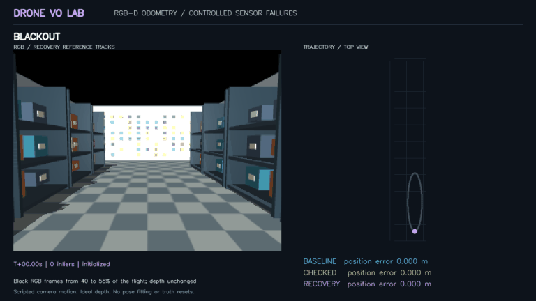
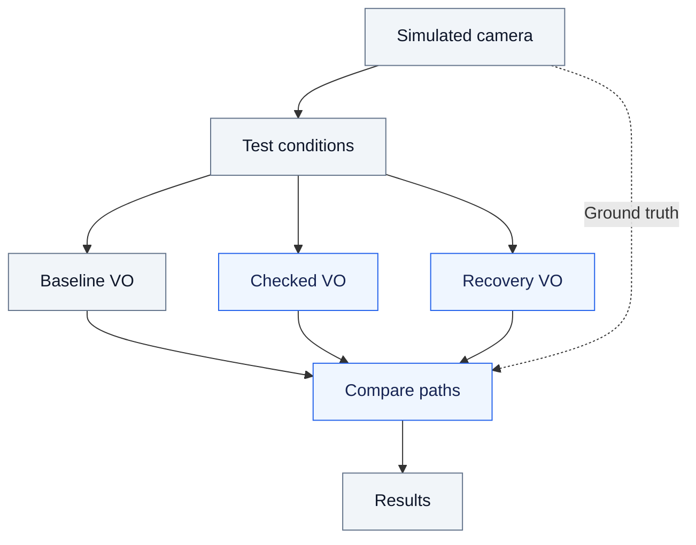
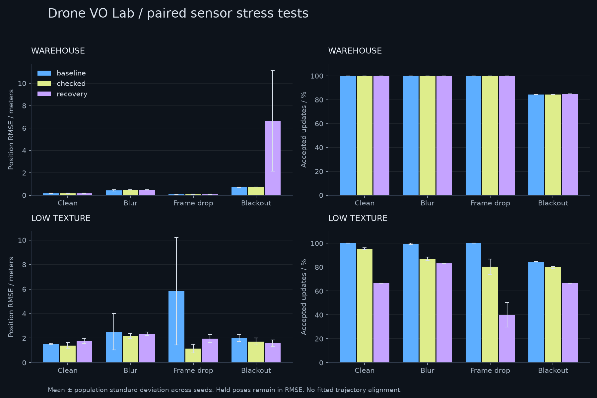

# Visual Odometry Lab

**How accurately can a camera estimate its movement when images blur, frames go missing, or the view goes dark?**

This project estimates a camera's movement through simulated indoor environments, then compares the estimated path with the true path. It tests whether extra reliability checks reduce localization errors when camera observations become less useful.

Built with **Python, OpenCV, and MuJoCo**. Runs locally on a CPU, without pretrained models or external scene downloads.



The preview shows the warehouse blackout test, including an incorrect recovery estimate. See the results below for the tradeoff.

[Results chart](artifacts/summary.png) · [Detailed findings](docs/findings.md) · [Raw results](artifacts/results.csv)

## What problem does it explore?

Robots, drones, and autonomous vehicles need to estimate their movement. **Visual odometry** does this using successive camera images. Small mistakes can accumulate, causing the estimated path to drift away from the actual path.

This project asks a practical question: **when a motion estimate looks unreliable, does rejecting it cause less error than accepting it?**

It provides a controlled way to investigate that tradeoff before testing with real sensors. The camera follows a scripted path; this project evaluates motion estimation rather than controlling a flying drone.

## How it works

1. **Create an indoor scene.** MuJoCo renders a warehouse or a version with fewer distinctive visual details.
2. **Move a virtual camera.** Capture color images and depth images, which record distance along the camera's viewing axis at each pixel. Together, these are called **RGB-D** observations.
3. **Make observations harder to use.** Produce clean, blurred, dropped-frame, and blackout versions of the same recording.
4. **Estimate movement.** OpenCV tracks image features, such as corners. Their depth gives their 3D positions, which are used to calculate camera translation and rotation. Position and orientation together are called a **pose**. Successive poses form a trajectory.
5. **Compare against the true path.** The simulator knows the actual camera poses, called **ground truth**. These are used for evaluation, never supplied to the motion estimator.

All three estimator configurations receive exactly the same observations for each condition.

| Condition | What changes |
| --- | --- |
| Clean | Original color and depth images |
| Motion blur | Apply a horizontal 21-pixel blur to color images |
| Dropped frames | Keep every fourth color-and-depth pair by default |
| Blackout | Replace color images with black during 40–55% of the recording |

Depth remains ideal in these experiments. A random seed makes the scene variations and camera path repeatable.

## Architecture



All estimators receive the same observations. Ground truth is kept outside motion estimation and used to measure error.

See [design decisions](docs/architecture.md) for the reasoning and implementation details.

## What is being compared?

The **baseline** tracks features and estimates movement using RANSAC PnP, a method that finds camera motion while rejecting feature matches that disagree with it.

The **checked** version uses the same pipeline with two additional safeguards:

- Track each feature forward into the next image and backward again. Keep the match only if it returns within 0.8 pixels of its starting point.
- Accept a motion estimate only when at least 12 feature matches support it and those matches account for at least 35% of the correspondences supplied to pose estimation.

These checks filter feature matches and accept or reject **motion estimates**. They do not assign a blur score to an entire frame.

The **recovery** version uses the same checks but retains its last reference image and depth after rejection. If a later image still matches that reference, it can estimate movement across the gap. After 30 consecutive failed observations by default, it replaces the reference while holding the pose and marks the gap as unrecovered.

Baseline and checked always advance their image reference, so rejected movement remains missing. Recovery attempts to bridge that movement, but it can also accept a wrong match. All modes hold their pose during rejected updates; none rewrites earlier estimates.

## What did the experiment show?

The committed experiment contains **72 runs**: two scenes × three seeds × four conditions × three estimators. Each source recording contains 180 frames at 15 frames per second. Recovery uses a limit of 30 consecutive failed observations.

The table reports **position RMSE**, a measure of the distance between estimated and true positions over a recording. Lower is better; larger mistakes contribute more strongly. Each value is the mean across three seeds.

| Scene and condition | Baseline | Checked | Recovery |
| --- | ---: | ---: | ---: |
| Warehouse, clean | 0.163 m | 0.182 m | 0.182 m |
| Warehouse, blackout | 0.720 m | 0.732 m | 6.667 m |
| Low texture, clean | 1.539 m | 1.404 m | 1.765 m |
| Low texture, dropped frames | 5.822 m | 1.156 m | 1.958 m |
| Low texture, blackout | 2.020 m | 1.725 m | 1.588 m |

The checked estimator reduces mean position RMSE by about **80%** relative to baseline in the low-texture, dropped-frame condition. This is a result for that specific simulated condition, not every test.

**Recovery is experimental and does not consistently improve accuracy.** In warehouse blackout seed 2 it reduces RMSE from 0.738 m for checked to 0.297 m. In seeds 0 and 1, it accepts incorrect gap-spanning estimates and RMSE rises to about 9.85 m. An accepted recovery event means the algorithm's checks passed, not that the recovered movement was correct.

We report error alongside **tracking coverage**, the percentage of accepted motion updates. Held poses after rejection still count toward error. A successful recovery may span several observations, so coverage is not the percentage of physical movement recovered. Comparisons use only initial-frame alignment, without fitting estimates to the true path.



See the [findings](docs/findings.md) for per-seed recovery results and the [methodology](docs/methodology.md) for algorithm settings, event definitions, timing, and evaluation details.

## Run it locally

Use Python 3.11 or newer. On macOS or Linux:

```bash
git clone https://github.com/amoghskanda/drone-vo-lab.git
cd drone-vo-lab
python3 -m venv .venv
source .venv/bin/activate
pip install -e '.[dev]'
drone-vo benchmark --quick --output runs/demo
```

The quick run uses one scene, one seed, and 90 frames, testing all three estimators under all four conditions for 12 runs. It is a smaller experiment than the 72-run results above.

Open `runs/demo/index.html` in your browser to explore the trajectories and results. On macOS:

```bash
open runs/demo/index.html
```

The report opens locally without a web server. The same output folder contains a generated `demo.mp4`, `demo.gif`, results in CSV and JSON, and per-frame trajectory logs. Add `--no-video` to skip MP4 and GIF generation while keeping the report and metrics.

The GIF preview and results chart above can be viewed directly on GitHub. The interactive HTML report and MP4 are generated locally and excluded from Git tracking.

### Reproduce the full experiment

```bash
drone-vo benchmark --output runs/full --scenes warehouse low_texture --seeds 0 1 2
```

The committed results use the default frame-drop interval of 4. To try a different interval:

```bash
drone-vo benchmark --quick --frame-interval 2 --output runs/interval-2
```

Set the recovery window with `--max-recovery-failures 15`, for example. This counts rejected observations, not seconds, and is recorded in the experiment metadata. Per-frame logs record successful recovery and reference expiry; summary metrics count both types of event.

`--frame-interval 2` keeps frames 0, 2, 4, and so on in the dropped-frame condition, preserving their original timestamps. The interval must be a positive integer that leaves at least two observations. Without `--output`, runs are saved in a timestamped folder under `runs/`.

<details>
<summary>Installation and rendering notes</summary>

`requirements-lock.txt` records the dependency versions used for the committed results. To use those versions, install with `pip install -r requirements-lock.txt` before the editable install.

On a Linux machine without a display, install and select a supported rendering backend. The CI workflow uses software OSMesa:

```bash
sudo apt-get install libosmesa6
MUJOCO_GL=osmesa drone-vo benchmark --quick --no-video
```

On macOS, run with normal Python in a graphical login session. The default renderer requires that session even though the project does not open a simulator window.

</details>

## Learning resources

- [Lucas-Kanade Method | Optical Flow](https://youtu.be/6wMoHgpVUn8). Video explanation of Lucas-Kanade optical flow, the method used for feature tracking in this project.
- [OpenCV optical-flow tutorial](https://docs.opencv.org/4.x/d4/dee/tutorial_optical_flow.html). An implementation guide for tracking selected features with `cv2.calcOpticalFlowPyrLK()`.

## Read the code

Follow this order to trace a run from the command line to the report:

| File | Purpose |
| --- | --- |
| [cli.py](drone_vo_lab/cli.py) | Read command-line options and start a run |
| [benchmark.py](drone_vo_lab/benchmark.py) | Apply image degradations, run comparisons, and save results |
| [scene.py](drone_vo_lab/scene.py) | Build environments and capture images, depth, and true poses |
| [odometry.py](drone_vo_lab/odometry.py) | Track features and estimate camera movement |
| [geometry.py](drone_vo_lab/geometry.py) | Handle camera geometry, pose transforms, and error calculations |
| [report.py](drone_vo_lab/report.py) | Generate charts, replay videos, and the local HTML report |

Run the checks with:

```bash
pytest
ruff check .
```

To include the rendering integration test, which requires a working graphics backend:

```bash
RUN_RENDER_TESTS=1 pytest
```

## Scope and limitations

This is classical RGB-D visual odometry evaluated on small synthetic scenes. The current implementation has no learned model, inertial sensor fusion, or mechanism to revisit known places and correct accumulated drift. Recovery requires overlapping views and reliable matching to its retained reference. It can produce large errors in repetitive scenes; reference expiry restarts local tracking without recovering the lost displacement.

Depth has no added sensor noise, blur is an image filter, and camera movement is scripted. Results establish behavior on these recordings; real-flight accuracy and onboard performance remain untested. The two consistency/support safeguards are evaluated together, so their individual contributions have not been isolated.

Original procedural scenes and estimator integration. No external meshes, datasets, or trained models are bundled. [MIT license](LICENSE).
