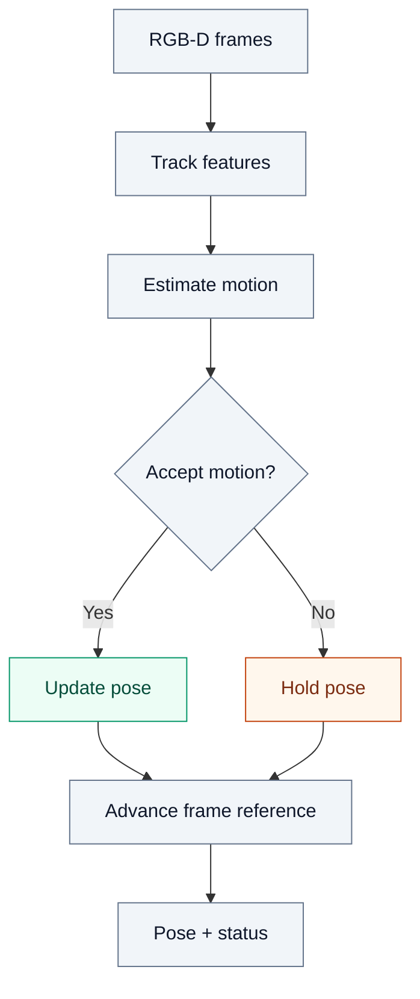

# Architecture and design decisions

The project separates observation generation, motion estimation, evaluation, and presentation. The [README architecture diagram](../README.md#architecture) shows the overall flow. These are Python modules in one local application, with the experiment runner coordinating them.

## Why these boundaries exist

| Decision | Implementation | Reason and tradeoff |
| --- | --- | --- |
| Keep the estimator independent of simulation | `RGBDOdometry` receives calibration, color images, and depth. It does not import MuJoCo or receive true poses. | Accuracy is measured against information the estimator did not have. A future recorded RGB-D input could use the same estimator interface, but that loader is not implemented yet. |
| Compare both modes on the same observations | Capture one sequence for each scene and seed. Derive each observation variant from it, then run both estimators on that variant. | Differences reflect estimator behavior under matched inputs. Both modes share feature tracking and pose estimation; the checked mode adds two safeguards. |
| Make rejection explicit | Every update returns an `Estimate` with a pose, acceptance flag, reason, and diagnostic counts. Rejected updates hold the last pose. | Rejecting a bad increment can prevent large drift. Rejecting a good increment loses real movement. Both remain visible in the results. |
| Measure accuracy together with coverage | Evaluation includes held poses in error and reports the proportion of accepted updates. Only the initial coordinate frame is aligned. | Rejecting difficult updates cannot remove their timestamps from error measurement. There is no trajectory fitting or reset to ground truth. |
| Keep reporting outside estimator timing | `update()` times estimator work. The runner evaluates and saves results; `report.py` builds plots, the report, and optional replay files afterward. | Processing times describe the estimator rather than rendering or encoding. They do not establish end-to-end onboard performance. |

Ground-truth poses also appear in saved reference logs and report visualizations. For display, estimated trajectories are placed in world coordinates using the first true camera pose. This does not feed back into the estimator or correct its accumulated trajectory.

## What happens during an update?



The diagram groups failure paths. Missing features, failed optical flow, or failed PnP also lead to a held pose. On the first observation, the estimator stores the image and depth and initializes its pose to identity. That initialization is excluded from tracking coverage and timing summaries.

Both modes require at least six PnP inliers, which are feature correspondences supporting the estimated motion. The checked mode additionally keeps forward/backward discrepancies below 0.8 pixels and requires at least 12 inliers with an inlier fraction of at least 35%.

After a rejected `A → B` update, the next attempt is `B → C`. Both image and depth references advance even when the pose does not. The implementation does not recover the displacement missed between A and B.

## Data passed between modules

`N` is the captured frame count, `M` is the number of observations retained for a condition, and `H` and `W` are image height and width. `P` below is a variable feature count.

| Data | Shape or contents | Used by |
| --- | --- | --- |
| `Sequence.rgb` | `N × H × W × 3`, color images | Observation variants and estimator inputs |
| `Sequence.depth` | `N × H × W`, depth along camera Z in meters | Motion estimation |
| `Sequence.calibration` | `3 × 3`, focal lengths and image center | Pixel-to-3D conversion and PnP |
| `Sequence.timestamps` | `N`, seconds | Logs, replay, and retained-observation timestamps |
| `Sequence.poses` | `N × 4 × 4`, true camera poses in world coordinates | Evaluation, reference logs, and display |
| `indices` | `M`, original frame indices retained for a condition | Keep RGB, depth, timestamps, and reference poses matched |
| `Estimate` | One `4 × 4` pose; accepted flag; reason; feature and inlier counts; processing time; current and previous pixel arrays shaped `P × 2` | Evaluation, per-frame logging, and replay |

The runner passes images and the depth at matching retained indices to each estimator. Observation variants preserve the source recording. Blur and blackout modify RGB only; frame dropping selects matching RGB-D pairs and preserves their original timestamps.

## Estimator state and pose convention

Each `RGBDOdometry` object owns its own state:

```text
calibration       3 × 3 camera matrix, copied at initialization
mode              "baseline" or "checked"
pose              4 × 4 accumulated camera pose, initially identity
previous_gray     H × W previous grayscale image, initially None
previous_depth    H × W previous depth image, initially None
```

`Estimate` is a separate dataclass returned by an update, not the estimator's persistent state. Its pose is copied so later updates do not alter earlier pose snapshots.

`T_a_b` maps points from coordinate frame b to coordinate frame a. PnP estimates the previous camera's 3D points expressed in the current camera frame. Camera pose accumulation therefore uses its inverse:

```text
T_first_current = T_first_previous @ inverse(T_current_previous)
```

See [geometry.py](../drone_vo_lab/geometry.py) and the [methodology](methodology.md) for camera axes, depth conventions, and metric definitions.

## Scope of the architecture

The application runs experiments locally and sequentially. Camera motion is prescribed, depth is ideal, and the two safeguards are tested together. Real sensor ingestion, flight control, inertial fusion, and correction through revisiting known places are outside the current implementation.
